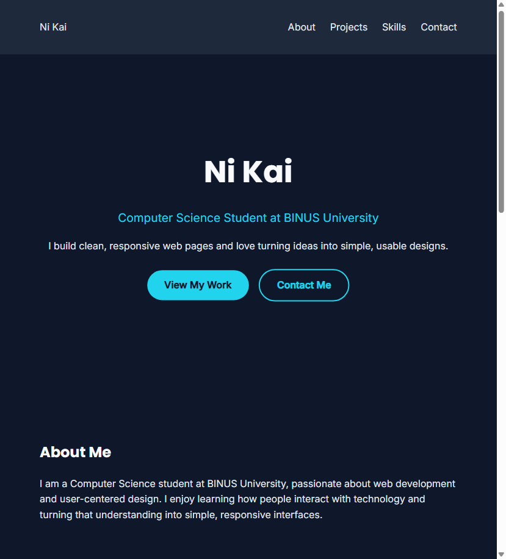
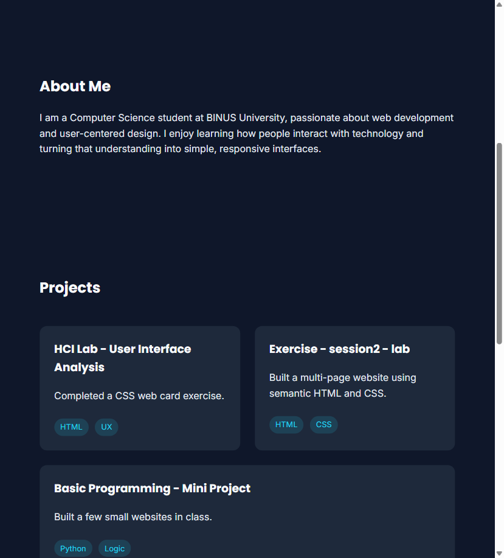
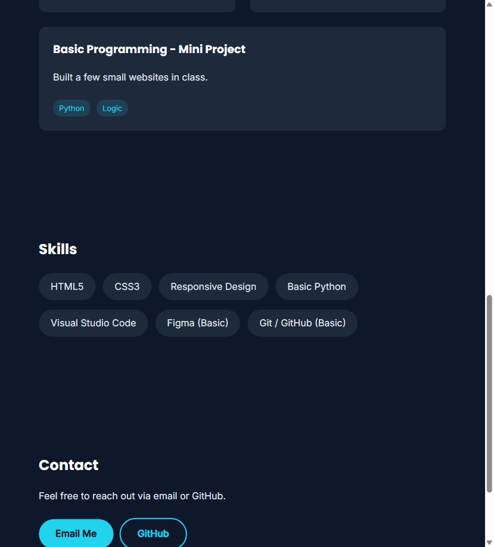

# 🌐 Personal Portfolio Website

## 📖 Project Overview

This is a single-page responsive portfolio website created as part of the Human Computer Interaction lab assignment. The website showcases personal information, projects, skills, and contact details. This version is built with **HTML**, **CSS**, and **JavaScript**, adding interactive behavior on top of the original HTML/CSS layout.

* URL Link to website portfolio: [Click Here](https://nkznb.github.io/portfolio/)

* URL Link to website design: [Click Here](https://www.figma.com/design/dbSJ933wyWeYTJDBq7mciZ/Untitled?node-id=0-1\&t=6RiLb3hTCtvrHd8S-1)

## 🎯 Purpose

The goal of this project is to:

* Practice responsive web design techniques
* Learn how to structure and style a webpage with semantic HTML and CSS
* Add JavaScript interactivity: DOM selection, event listeners, scroll behavior, and state management
* Showcase personal and course projects in a professional format

## 👥 Target Audience

This portfolio is designed for:

* [x] Potential employers or recruiters

* [x] Academic advisors / lecturers

* [x] General public / personal branding

> Note: The projects shown on this page are my actual HCI and web programming lab exercises.

## 🧱 Technologies Used

* HTML5

* CSS3 (Flexbox, Box Model, Media Queries, Transitions)

* JavaScript (DOM, Event Listeners, IntersectionObserver, localStorage)

* Google Fonts (Poppins, Inter)

## 📐 Layout & Sections

* **Header / Nav** – Logo, navigation links, theme toggle, and mobile menu button

* **Hero** – Name, tagline, and call-to-action buttons

* **About Me** – Short bio

* **Projects** – Three course project cards with hover lift effect

* **Skills** – Technical and tool skills as pill tags

* **Contact** – Email button and GitHub link

* **Footer** – Copyright and back-to-top link

## ⚡ JavaScript Interactive Features

* **Mobile navigation menu** – Hamburger button opens and closes the navigation on small screens

* **Smooth scrolling** – Nav links and buttons scroll smoothly to their target sections

* **Back-to-top button** – Appears after scrolling down; returns to the top on click

* **Scroll reveal animation** – Sections and cards fade in as they enter the viewport

* **Active nav highlight** – The current section's navigation link is highlighted while scrolling

* **Light / dark theme toggle** – Switches the color theme and remembers the choice in localStorage

## 📱 Responsiveness

The site is optimized for:

* Desktop

* Tablet

* Mobile

> Responsive design is achieved using media queries (max-width: 768px), flex-wrap, and relative units (%, rem, vw).

## 🧪 How to Run Locally

1. Clone the repository:

```
git clone https://github.com/nkznb/portfolio.git
```

2. Open `index.html` in your browser, or use the Live Server extension in VS Code.

## 📂 Folder Structure

```
portfolio/
│
├── index.html
├── style.css
├── script.js
├── images/
└── README.md
```

## 👨‍🎓 Author

* Name: Ni Kai

* Student ID: 3002912335

* Class: B1BC

* Major: Computer Science, BINUS University

## 📄 Notes

* Color scheme: dark navy + cyan accent, with a light theme variant

* Project descriptions, bio, and contact section written manually

* JavaScript behavior is implemented in `script.js`

## 📸 Screenshots

**Desktop view:**






