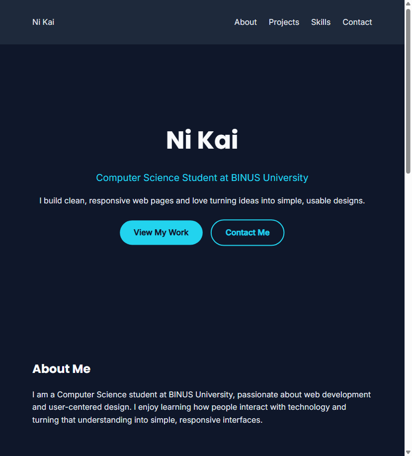
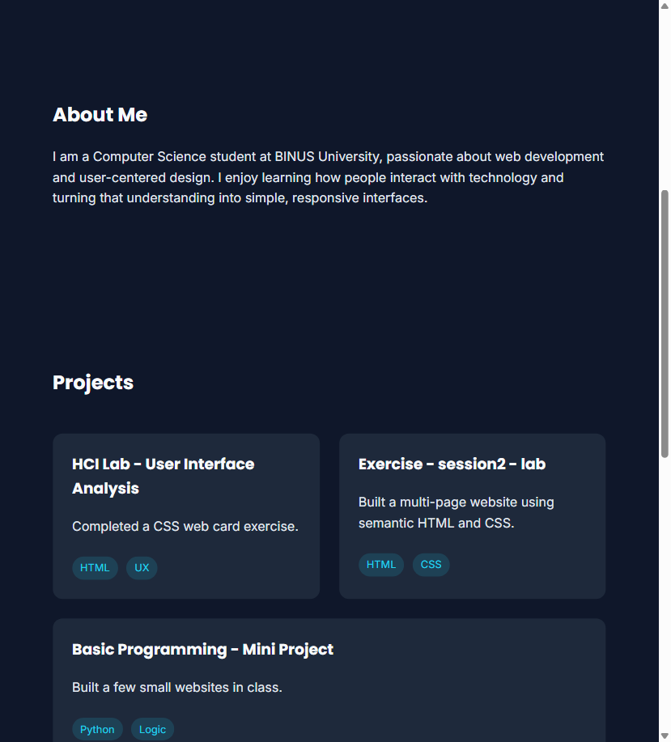
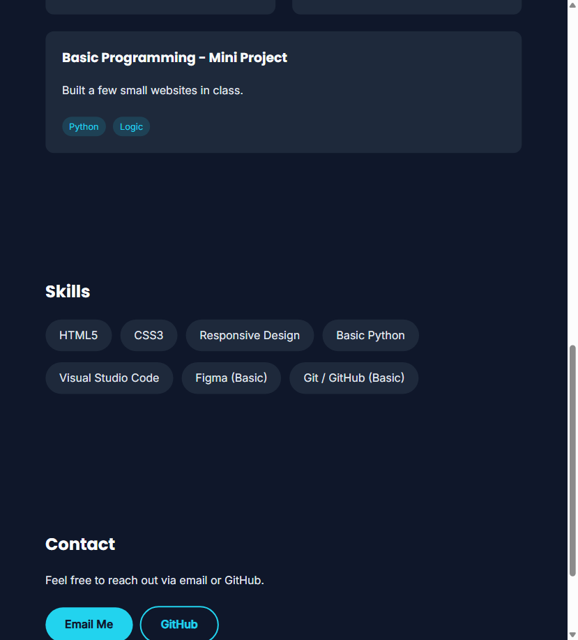

# 🌐 Personal Portfolio Website

## 📖 Project Overview

This is a single-page responsive portfolio website created as part of the HCI Lab Week 6 assignment. The website showcases personal information, projects, skills, and contact details. It is built using **HTML** and **CSS** only (no JavaScript).


* URL Link to website portfolio: [Click Here](https://nkznb.github.io/portfolio/)

* URL Link to website design: [Click Here](https://www.figma.com/design/dbSJ933wyWeYTJDBq7mciZ/Untitled?node-id=0-1\&t=6RiLb3hTCtvrHd8S-1)

## 🎯 Purpose

The goal of this project is to:


* Practice responsive web design techniques

* Learn how to structure and style a webpage with semantic HTML and CSS

* Showcase personal and course projects in a professional format

## 👥 Target Audience

This portfolio is designed for:


* [x] Potential employers or recruiters

* [x] Academic advisors / lecturers

* [x] General public / personal branding

> Note: The projects shown on this page are my actual HCI and web programming lab exercises.

## 🧱 Technologies Used


* HTML5

* CSS3 (Flexbox, Box Model, Media Queries, Transitions)

* Google Fonts (Poppins, Inter)

## 📐 Layout & Sections


* **Header / Nav** – Logo and navigation links (About, Projects, Skills, Contact)

* **Hero** – Name, tagline, and call-to-action buttons

* **About Me** – Short bio

* **Projects** – Three course project cards with hover lift effect

* **Skills** – Technical and tool skills as pill tags

* **Contact** – Email button and GitHub link

* **Footer** – Copyright and back-to-top link

## 📱 Responsiveness

The site is optimized for:


* Desktop

* Tablet

* Mobile

> Responsive design is achieved using media queries (max-width: 768px), flex-wrap, and relative units (%, rem, vw).

## 🧪 How to Run Locally


1. Clone the repository:


```
git clone https://github.com/nkznb/portfolio.git
```


1. Open `index.html` in your browser, or use the Live Server extension in VS Code.

## 📂 Folder Structure


```
portfolio/
│
├── index.html
├── style.css
├── images/
└── README.md
```

## 👨‍🎓 Author


* Name: Ni Kai

* Student ID: 3002912335

* Class: B1BC

* Major: Computer Science, BINUS University

## 📄 Notes


* I used AI tools as a tutor to explain HTML/CSS concepts (Flexbox, media queries) and to review/debug my code; I wrote all HTML and CSS files myself.

* I designed the color scheme (dark navy + cyan accent) and layout myself.

* I wrote the project descriptions, bio, and contact section manually.

## 📸 Screenshots

**Desktop view:**





